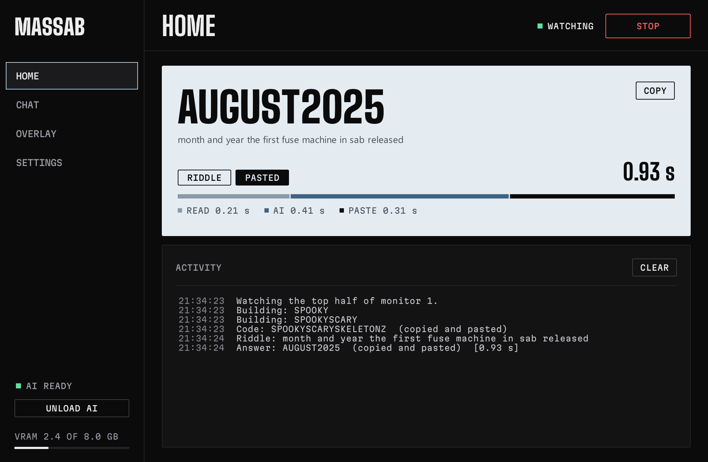
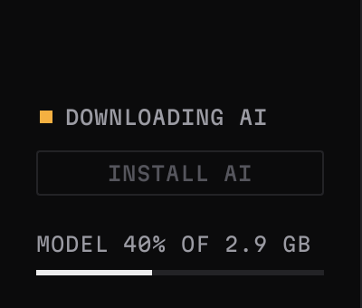
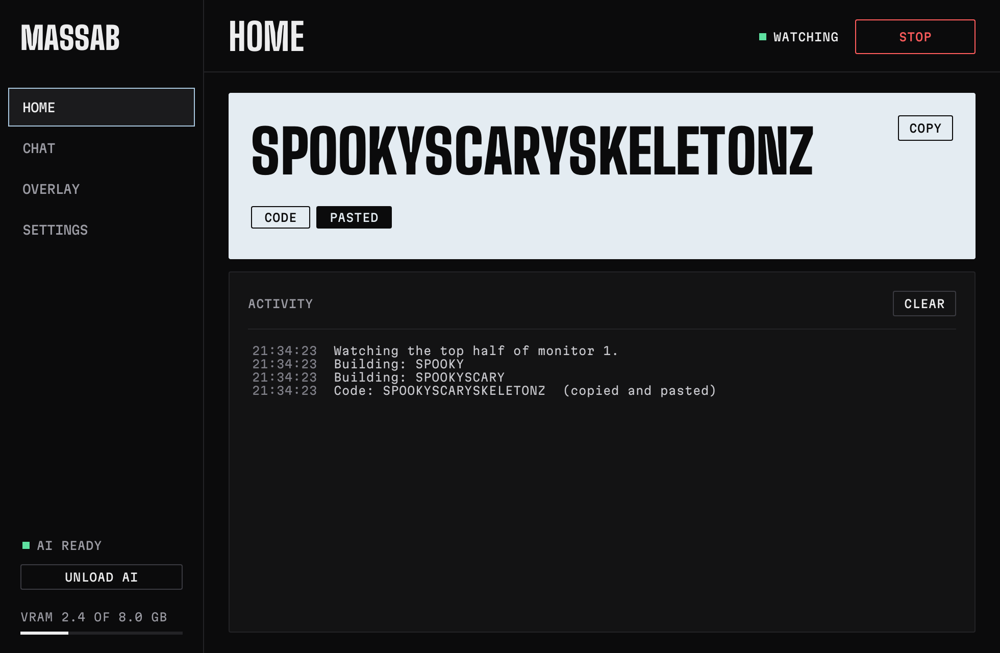
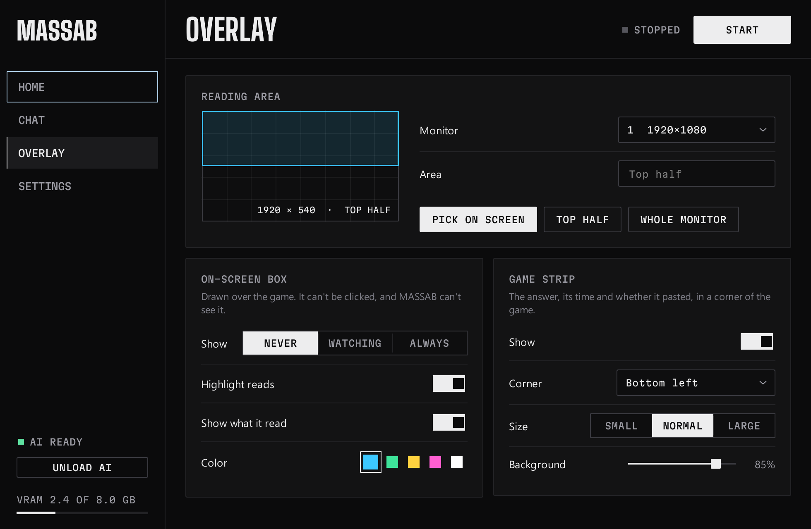
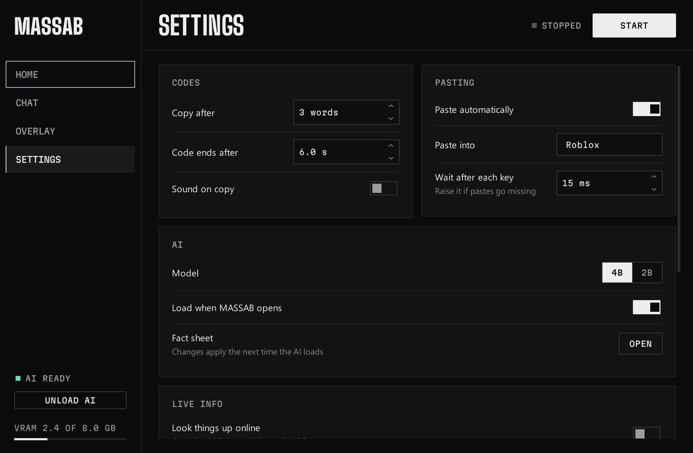
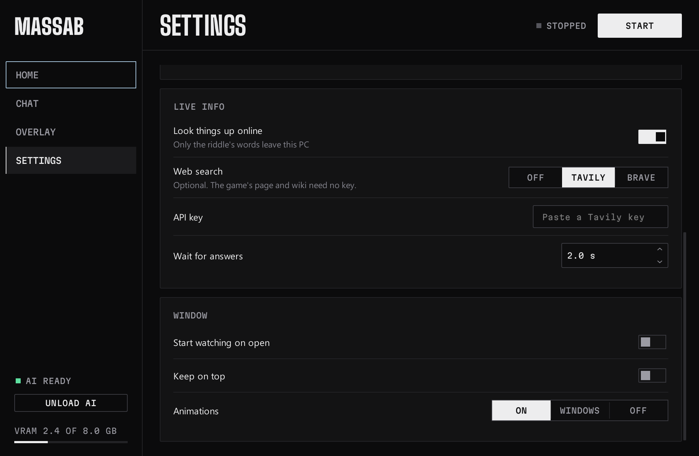

<div align="center">

# MASSAB

**A lightweight, locally hosted AI assistant that detects Roblox stream promo codes and solves game trivia in real time using OCR and GPU-accelerated language models. Features automated code assembly, intelligent riddle solving, and clipboard integration.**


[Getting started](#getting-started) · [Using MASSAB](#using-massab) · [Settings](#settings) · [Troubleshooting](#troubleshooting) · [How it works](#how-it-works)

</div>



- **Codes.** Code words arrive one line at a time and scroll away. MASSAB joins them into one code and pastes it as soon as it's in.
- **Riddles.** A small AI on your own GPU answers game trivia from a fact sheet, usually in about a second.
- **Riddles about now.** "What year is it" is answered from your PC's clock. Turn on [live info](#riddles-about-today) and "the most op brainrot that released today" is looked up on the game's Roblox page and wiki.
- **Nothing to pick.** It watches for both at once and works out which one is on screen.
- **Never submits.** It types the answer into the Codes box; pressing Redeem is up to you.
- **Runs locally.** No account and no API key. Nothing is sent anywhere unless you turn on live info, and then only the riddle's words are sent.

## Contents

- [Requirements](#requirements)
- [Getting started](#getting-started)
- [Using MASSAB](#using-massab)
- [Settings](#settings)
- [The fact sheet](#the-fact-sheet)
- [Riddles about today](#riddles-about-today)
- [Troubleshooting](#troubleshooting)
- [Command line](#command-line)
- [How it works](#how-it-works)
- [Known limits](#known-limits)
- [Project layout](#project-layout)
- [Disclaimer](#disclaimer)
- [License](#license)

## Requirements

| | |
|---|---|
| **System** | Windows 10 or 11 |
| **Python** | 3.14 from [python.org](https://www.python.org/downloads/), with "Add python.exe to PATH" ticked |
| **For riddles** | An NVIDIA GPU with about 3 GB of free VRAM, and 3 GB of disk space for the AI. Codes work without it. |

Tested on Windows 11 with an 8 GB RTX 4060.

## Getting started

1. **Download MASSAB.** On GitHub, click **Code → Download ZIP** and unzip it anywhere, or `git clone` it.
2. **Double-click `MASSAB.bat`.** The first time, it sets up everything Python needs in a `.venv` folder, which takes a few minutes. After that it opens straight away.
3. **Install the AI** (only for riddles). Click **Install AI** at the bottom left. It downloads the AI program and model, about 3 GB, checks them, and loads them. You can close MASSAB partway: the download picks up where it stopped.

   

Once MASSAB has opened, there's also a `MASSAB` shortcut with the M icon in the folder. Pin that to your taskbar or Start menu. MASSAB remakes it whenever it's missing or the folder has moved.

<details>
<summary>Setting up by hand instead</summary>

```bash
py -3.14 -m venv .venv
.venv\Scripts\python -m pip install -r requirements.txt
.venv\Scripts\python app\setup_ai.py
.venv\Scripts\pythonw app\gui.py
```

`setup_ai.py --model 2b` downloads the smaller model instead, for GPUs with less VRAM.
</details>

## Using MASSAB

1. Open the **Codes** menu in Roblox and click its text box.
2. Press **Start** in MASSAB and go back to the game.
3. When a code or riddle shows up on the stream, MASSAB pastes the answer. Check it, then press Redeem.



**Home** shows the last answer, how long reading, the AI and pasting took, and a log of everything MASSAB saw. **Chat**, **Overlay** and **Settings** are in the sidebar; Ctrl+1 to Ctrl+4 switch between them.

A small strip in a corner of the game shows each answer and whether it pasted, so you don't need to look at MASSAB while playing. It can't be clicked and never takes focus, because pasting only works while the active window is titled exactly `Roblox`. If it isn't, the answer is still copied.

### What gets read

Codes come one word at a time, in lines that scroll up and disappear after a few seconds:

```
here is the code...
it contains no numbers
SAB
IS
AMAZING
```

MASSAB works out which lines are the code and pastes `SABISAMAZING`.

Riddles come after an intro, often in one long message that wraps onto two rows:

```
the riddle is
What brainrot is scarino crowino a reskin
of? and what day in may did sab release
```

The answer is pasted as `FISHINOCLOWNINO15`: its parts joined together, the way the streamer's codes are. A riddle called a code, like `the code is the rarity of dragon cannelloni and 67`, is solved too, so the answer is `SECRET67`, not the sentence.

A riddle needs an intro, just as a code does, so everyday chat is left alone:

- **Riddle intros** have the word riddle, trivia, quiz or puzzle, or wording like "the question is": "here is the riddle...", "riddle is", "RIDDLE TIME".
- **Code and prize lines** like "the code is...", "this is for 100 dragons" or "5 skibidis" can lead to either. Only a sentence or question after one counts as a riddle, so `KEYBOARD` stays a code.
- **Lines about one that's over**, like "that was a bad riddle" or "the answer was X", are ignored.

MASSAB is built for one overlay style: white outlined text near the top center of the screen, with a red-hat emoji icon beside each line. Other overlays aren't detected.

### Where it reads



By default MASSAB reads the top half of your main monitor, all the way across, which is where the overlay is. On the **Overlay** page:

- **Pick on screen** lets you drag a box over the part to read, or type it as `x,y,w,h` in pixels. **Top half** and **Whole monitor** are one click.
- For a stream in a browser window, drag across the video's full width, from its top edge down about halfway.
- The **On-screen box** draws the area over the game and can label each line with what was read. It's the quickest way to check MASSAB is looking in the right place, and MASSAB can't see it, so it never reads its own labels.
- The **Game strip** can sit in any corner, in three sizes.

### Chat

The Chat page talks to the same AI that solves riddles, once it's loaded. With **Use the fact sheet** on, questions about the game get the matching lines of the fact sheet. Chat always knows today's date, and with [live info](#looking-things-up-online) on, questions about the game right now are looked up first. Replies are short, because the model is small. A riddle on screen always comes first and cuts off any reply that's still coming in.

## Settings



| Setting | What it does |
|---|---|
| **Copy after** | Paste once this many words of a code are in, and again if more come. *Whole code* waits for the end. |
| **Code ends after** | Seconds with no new word before a code counts as finished |
| **Sound on copy** | A short Windows sound whenever a code or answer is copied |
| **Paste automatically** | Off: answers are only copied |
| **Paste into** | Only paste while the active window has exactly this title |
| **Wait after each key** | Raise it if pastes go missing or come out wrong (default 15 ms) |
| **Model** | 4B gives the best answers; 2B uses less VRAM |
| **Load when MASSAB opens** | So the first riddle doesn't wait for the AI to load |
| **Look things up online** | Off by default. On: riddles about now are looked up on the game's Roblox page and wiki. See [Riddles about today](#riddles-about-today) |
| **Web search** | Optional, on top of those: *Tavily* or *Brave*, with your own API key |
| **API key** | The web search's key. It's kept in Windows Credential Manager, never in `settings.json` |
| **Wait for answers** | How long a riddle waits for lookups before it's answered without them (default 2 s) |
| **Start watching on open** | Starts reading as soon as MASSAB opens |
| **Keep on top** | Keeps the window above the game |
| **Animations** | On, off, or follow Windows' Animation effects setting |

Settings that only take effect when watching starts, like the reading area and pasting, are greyed out until you press Stop. Live info settings apply to the next riddle, even while watching. Settings are saved in `app\settings.json`.

## The fact sheet

`app/data/sab_facts.md` is what makes trivia work. For each riddle the AI gets the few lines that best match it. If no lines cover most of the riddle, it gets none, and the answer is marked **GUESS**: don't trust those.

- One fact per line, ending in `[source: url]`.
- Lines starting with `#` are ignored, and so is everything under `## Needs review`.
- When the streamer reveals an answer, add what it proves to `## Answers Sammy confirmed`.

**Settings → Fact sheet → Open** opens it. Changes apply the next time the AI loads. The AI's instructions are in `app/prompts/riddle_system.txt`; replies must keep the `ANSWER:` format, and `ANSWER: NONE` means nothing is pasted.

## Riddles about today

The fact sheet is a snapshot, and the AI's own idea of the date is wherever its training stopped. MASSAB reads each riddle's wording to tell what it depends on:

| The riddle | Example | What MASSAB does |
|---|---|---|
| Only about the date | "what year is it", "what day of the week is tomorrow", "how many days until christmas" | Works it out from your PC's clock and pastes it. The AI isn't asked. |
| About the date some other way | "what is todays date", "what month and year is it" | Today's date, yesterday's and tomorrow's go into the AI's prompt. |
| About the game right now | "the most op brainrot that released today", "what is the latest update", "how many people are playing right now" | Looked up online, if you've turned that on. |
| About something newer than the fact sheet | "what rarity is balloon baboon" | Looked up on the wiki, if you've turned that on and the fact sheet has never heard of the name (even allowing for misspellings) or doesn't cover the riddle. |
| Everything else | Game trivia, classic riddles | Exactly as before. No date and no lookup, so "month and year the fuse machine released" can't turn into this month. |

Dates use your PC's clock and time zone, the same ones `and the day today` uses. "What day is it" on its own isn't answered from the clock, because it could mean Wednesday or the 11th, so the AI gets the date and decides.

### Looking things up online

**Settings → Live info → Look things up online** turns it on. It's off until you do, and with it off MASSAB never goes online for riddles.



Two sources need no account or key:

- **The game's Roblox page** (official). Its event posts are the patch notes, with each update's real start time. A riddle about players or visits reads the live numbers too.
- **The Steal a Brainrot wiki** (community). A page for each new Brainrot goes up within minutes of its update. MASSAB reads the pages made in the last three weeks and the wiki's update log, and searches the wiki for a Brainrot the fact sheet doesn't know.

You can add a **web search** on top, with your own API key: [Tavily](https://tavily.com) (free plan: 1,000 searches a month) or [Brave Search](https://brave.com/search/api). Pick one under **Web search** and paste the key into **API key**. The key is kept in Windows Credential Manager as `MASSAB/tavily` or `MASSAB/brave`, never in `settings.json`, and never shown or logged. A `TAVILY_API_KEY` or `BRAVE_API_KEY` environment variable is used instead if it's set. A web search only runs for riddles about the game right now, not for the wiki lookups.

What goes out is the riddle's words and nothing else: no screenshots, nothing else from your screen, nothing about your PC. Requests use a generic name, not MASSAB's.

**What the AI sees.** Each looked-up item is labelled with its source, how much to trust it (official, then the wiki, then the web), and its dates in your PC's time. When an update started and when a post about it went up are kept apart, because a page posted today can be about last Saturday's update. For a riddle about "today" or "this week", items from those days are all it gets, with a line naming them. If there are none, a line says so and says which item is newest. The AI is told the text is from the internet, to ignore any instructions in it, and to answer `NONE` if it doesn't answer a riddle about now.

**On the Home page** an answer that used live info has a **LIVE** chip; hover it for the sources. The Activity log shows each lookup and the pages used. The game strip says *Looking up* while it waits.

**Speed.** The event posts and new wiki pages are fetched as soon as a riddle intro appears, so they're usually in hand before the riddle is. Everything is cached:

| What | Kept for | When a fresh copy can't be had |
|---|---|---|
| Event posts and new wiki pages | 5 minutes, and fetched again when an intro appears if over a minute old | The last copy is used for up to 6 hours |
| Player numbers | 2 minutes | Up to 10 minutes |
| Wiki searches | 30 minutes | Up to 6 hours |
| Web searches | 10 minutes for "today" and "yesterday", 1 hour otherwise | Up to 3 hours |

The same lookup never runs twice at once. A riddle waits at most **Wait for answers** (2 s by default), then goes on with whatever came back; anything that arrives later is still cached for the next riddle. A newer riddle cancels the wait.

**When it can't get online.** Nothing breaks. A source that fails is left alone for a while: 30 seconds when it can't be reached, 1 minute after a server error, 15 minutes after a refused key, or as long as a rate limit asks. The riddle is answered from the fact sheet as before, the log says why, and the answer is marked **GUESS: couldn't look it up**. With lookups off, a riddle about now is answered the old way and marked **GUESS: needs current info**. A riddle about a name that neither the fact sheet nor the wiki knows is marked **GUESS: name not in the facts**.

## Troubleshooting

| Problem | Fix |
|---|---|
| `MASSAB.bat` says Python isn't installed | Install Python 3.14 from python.org with "Add python.exe to PATH" ticked, then run it again |
| Nothing is read | Set **On-screen box** to *Always* on the Overlay page and check the box covers the overlay. For a stream in a browser, pick the video's area. |
| Answers are copied but not pasted | The game window must be active and titled exactly `Roblox`, or change **Paste into** |
| Pastes miss letters | Raise **Wait after each key** in Settings |
| Riddles are slow | Close other things using the GPU. The VRAM meter at the bottom left turns red when it's nearly full. |
| The AI says it isn't installed | Click **Install AI** again. A model that's already there and passes its check isn't downloaded twice. |
| Screen capture stops at a lock screen | Normal: Windows blocks it there. Watching carries on by itself afterwards. |
| The log says *Lookup failed* | Check your internet connection. *The API key was refused* means the web search's key is wrong or expired: paste a new one, or set **Web search** to *Off*. The Roblox page and wiki keep working without it. |
| A riddle about today is marked *GUESS: needs current info* | Turn on **Settings → Live info → Look things up online** |

## Command line

```bash
.venv\Scripts\python app\codereader.py
```

This reads codes and riddles together, like the window does, and prints what it finds:

```
[   5.3s] CODE: KEYBOARDESCAPEIS  (copied and pasted)  [3 words in, will update if more come]
[   7.2s] CODE: KEYBOARDESCAPEISBORING  (copied and pasted)  [updated: another word came in]
[  10.7s] done: KEYBOARDESCAPEISBORING
```

| Option | What it does |
|---|---|
| `--video FILE` | Read a recording instead of the screen |
| `--monitor N` | Monitor to watch (default 1, the primary) |
| `--region x,y,w,h` | Read only this area (default: the top half, all the way across) |
| `--fps N` | Frames to check per second (default 12); the code reader gets about 4 of them |
| `--words N` | Copy once this many words are in (default 3, 0 = wait for the end) |
| `--end-gap N` | Seconds with no new word before a code counts as finished (default 6) |
| `--copy-partial` | Update the clipboard with every new word |
| `--no-paste` | Copy but don't paste |
| `--no-copy` | Don't touch the clipboard, which also stops pasting |
| `--paste-window TITLE` | Paste into the window with this exact title (default `Roblox`) |
| `--key-delay N` | Milliseconds to wait after each key of a paste (default 15) |
| `--model NAME` | `4b`, or the smaller `2b` |
| `--online` | Look up riddles about now on the game's Roblox page and wiki |
| `--web-search NAME` | With `--online`, also search the web: `tavily` or `brave`. The key comes from `TAVILY_API_KEY` or `BRAVE_API_KEY`, or the one saved in Settings |
| `--lookup-wait N` | Seconds a riddle waits for lookups (default 2) |
| `--today DATE` | With `--video`, when the recording was made (`2026-11-10` or `2026-11-10T18:15`), so "what day is it today" is answered for that day, not the day you replay it |
| `--verbose` | Print every frame's OCR reads |

## How it works

**Codes**

1. **Find lines.** Each line is found by its icon: a yellow face with a red hat above and a red body below.
2. **Read lines.** The crop is trimmed to the white letters and read with RapidOCR.
3. **Track lines.** Lines are matched between frames by text and position, so each real line gets a vote from every frame it's seen in, and one-off misreads lose.
4. **Assemble the code.** A line containing "code" starts collecting. Hint lines are skipped, and the words after them form the code. Chatter or a new intro ends it. The intro waits up to 20 seconds for the first word, because streamers often pause after "the code is...".

**Riddles**

1. **Find rows.** White letters are chained to their neighbors, and only chains centered on the screen count. Rows about 24 pixels apart at 720p are one wrapped message.
2. **Wait for an intro.** Nothing counts until a riddle, code or prize intro. Lines above it came before it, so they're ignored.
3. **Track messages.** Two frames that agree make a riddle. A message of 5 or more words, or one ending in `?`, is the whole riddle; after a riddle intro, shorter lines add up like a code's words.
4. **Sort it.** The riddle's wording says whether it's only about the date (answered from the clock right here), about the date some other way, or about the game right now.
5. **Pick facts.** The fact sheet lines sharing the riddle's rarest words are chosen.
6. **Look things up**, if live info is on and the riddle is about now or names something the fact sheet doesn't cover. Sources are fetched in parallel, cached, and cut down to short dated items.
7. **Ask the model.** `llama-server` runs on localhost, and the reply is streamed so newer text can cancel it. The prompt has today's date and live info only when the riddle needs them.
8. **Finish the answer.** Exact steps are applied in code: `3 times` repeats the answer, a final `and 67` adds the number, and `and the day today` adds today's date.

## Known limits

- Only white letters with a dark outline are read, like the overlay's own. Coloured text, very large text, or a blurry stream can be missed.
- A code word that is exactly `CODE` looks like a new intro and splits the code. Symbols are dropped, so `X-RAY` becomes `XRAY`.
- Repeated words (`GO`, `GO`, `GO`) can gain or lose a copy if a line goes undetected right as another expires.
- All-caps chatter right after a code (`HURRY`, `GG`) can be added to it.
- Short number lines like `11` are read with low confidence and can be dropped.
- Riddles are only as good as the fact sheet. Riddles about today, like "the most op brainrot that released today", need live info turned on, and then they're only as good as the wiki and the game's event posts. Sammy's update posts are often teasers (`NEXT UPD`, `???`), so the wiki is usually what names the new Brainrots.
- "Today" is your PC's date. If you're in a different time zone from the stream, its "today" can be your yesterday or tomorrow.
- Which riddles are about now is decided from their wording ("today", "latest", "right now"...). One that asks about now in other words is answered from the fact sheet.
- A riddle with no intro is missed. A chatty sentence within 8 seconds of an intro can reach the AI; it answers `NONE` to most, but not all.
- A riddle told as several full sentences only gets its first one, and up to 2 seconds of short chatter right after a short riddle can join it.

## Project layout

```
MASSAB.bat            starts MASSAB, and sets it up the first time
requirements.txt      the Python packages it needs, pinned
app/
  gui.py              the window
  engine.py           the capture loop behind the window and the command line
  codereader.py       finds and reads code lines, and assembles codes
  riddle.py           finds riddle rows, tracks riddles, and talks to the AI
  today.py            today's date: answers date questions, and writes the date for the AI
  lookup.py           decides what a riddle needs, and looks it up online: caching, picking, the prompt's live info
  sources.py          the game's Roblox page, the wiki, Tavily and Brave
  keystore.py         keeps web search keys in Windows Credential Manager
  overlay.py          the on-screen box and area picker
  chat.py             the Chat page's model calls
  theme.py            colors, fonts and custom widgets
  setup_ai.py         downloads and checks the AI (also run by Install AI)
  shortcut.py         makes the MASSAB shortcut
  data/sab_facts.md   the fact sheet
  prompts/            the AI's instructions
  fonts/              Big Shoulders Display and Martian Mono (SIL Open Font License)
  bin/, models/       the AI, once installed (not in git)
docs/                 the screenshots in this README
```

The fonts' licenses are next to them in `app\fonts\`. Body text uses Windows' Segoe UI.

## Disclaimer

MASSAB is an independent fan project. It isn't affiliated with or endorsed by Roblox Corporation, the makers of Steal a Brainrot, or any streamer. It only reads what's on your own screen and types into your own game window, and it never presses Redeem for you. Use it in line with the rules of the games and streams you watch.

## License

MASSAB is licensed under the [GNU General Public License v3.0](LICENSE). The bundled fonts are under the SIL Open Font License; see `app/fonts/`.
